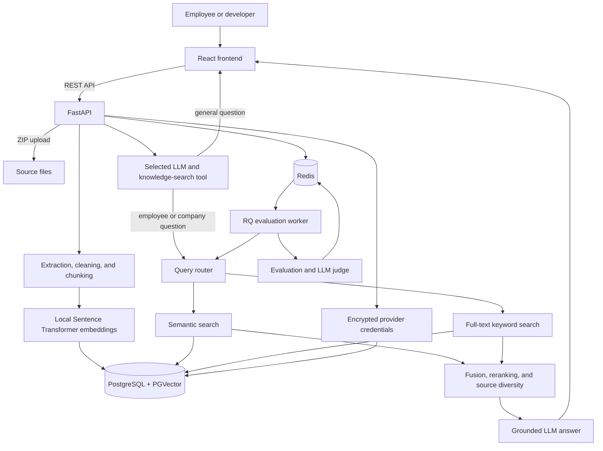

# Employee RAG System

A full-stack Retrieval-Augmented Generation (RAG) application for employee and
company knowledge.

Upload structured and unstructured files in a ZIP archive, process them into a
searchable knowledge base, and ask grounded questions through multiple LLM
providers. The developer workspace can also evaluate the complete RAG pipeline,
including retrieval quality, answer quality, grounding, citations, latency, and
estimated model cost.

## Features

- Structured and unstructured document ingestion
- Semantic, keyword, and hybrid retrieval
- LLM-directed knowledge search that skips retrieval for general questions
- Query rewriting, reranking, and source diversification
- Grounded answers with retrieved sources
- Hugging Face, OpenAI, Anthropic, and xAI Grok support
- Encrypted API-key storage with automatic expiry
- End-to-end RAG evaluation and provider comparison
- Token usage, approximate cost, and latency reporting
- Separate user and developer interfaces
- Chat locked until ingestion completes successfully

## Supported files

Files must be uploaded inside a `.zip` archive.

| Type | Extensions | Processing |
| --- | --- | --- |
| Unstructured | `.pdf`, `.docx`, `.txt`, `.md`, `.markdown` | Extraction, cleaning, Markdown normalization, and chunking |
| Structured | `.csv`, `.json`, `.xlsx` | Record and worksheet parsing followed by structured chunking |

Default limits are 50 MB per ZIP, 200 MB after extraction, and 1,000 files.
Unsupported entries are ignored. Existing filenames are preserved and new
duplicates receive a numeric suffix such as `handbook_1.pdf`.

## Architecture



## Technology

| Area | Tools | Purpose |
| --- | --- | --- |
| Backend | Python 3.12, FastAPI, Uvicorn, Pydantic | API, validation, ingestion, and evaluation |
| Frontend | React 19, TypeScript, Vite | User and developer interfaces |
| Frontend data | TanStack Query, React Router | API state, polling, mutations, and navigation |
| UI | Lucide React, Recharts | Icons and evaluation charts |
| Database | PostgreSQL 16, PGVector | Credentials, full-text search, vectors, and document metadata |
| Jobs | Redis 7, RQ | Ingestion state, locks, evaluation jobs, and results |
| RAG | LangChain | Provider and PGVector integrations |
| Embeddings | Sentence Transformers | Local document and query embeddings |
| Parsing | PyPDF, python-docx, openpyxl | PDF, DOCX, and XLSX extraction |
| Security | AES-256-GCM through `cryptography` | API-key encryption at rest |
| Infrastructure | Docker Compose | Persistent PostgreSQL/PGVector and Redis services |
| Testing | pytest, ESLint, TypeScript | Backend and frontend validation |

The default embedding model is
`sentence-transformers/all-MiniLM-L6-v2`, running locally on CPU.

## Documentation

| Guide | Contents |
| --- | --- |
| [Installation](docs/installation.md) | Detailed setup, startup order, configuration, and first-run checks |
| [Architecture](docs/architecture.md) | Components, storage, and ingestion, chat, and evaluation flows |
| [API reference](docs/api.md) | Endpoint catalog, request examples, statuses, and limits |
| [RAG evaluation](docs/evaluation.md) | Dataset creation, review workflow, metrics, pass rules, and jobs |
| [Security](docs/security.md) | Credential encryption, data handling, trust boundaries, and hardening |
| [Deployment](docs/deployment.md) | Current Compose scope, production topology, persistence, and operations |
| [Troubleshooting](docs/troubleshooting.md) | Common startup, ingestion, provider, and evaluation problems |

## Quick start

### Prerequisites

- Docker with Docker Compose
- Python 3.12 or newer
- [uv](https://docs.astral.sh/uv/)
- Node.js 20 or newer with npm
- An API key for at least one supported LLM provider

No `.env` file is required. Application defaults are stored in
`app/api/config.py`; API keys and model names are entered through the UI.

### 1. Install the backend and start infrastructure

From the repository root:

```bash
uv sync
npm --prefix frontend install
docker compose up -d
docker compose ps
```

Wait for PostgreSQL/PGVector and Redis to report healthy.

### 2. Start the frontend, API, and worker

From the repository root, start all three development processes with one
command:

```bash
npx concurrently --kill-others \
  "uv run uvicorn app.api.main:app --reload" \
  "uv run employee-rag-worker" \
  "npm --prefix frontend run dev"
```

The first run may ask permission to download `concurrently`. Press `Ctrl+C` to
stop all three processes. Open the frontend at `http://localhost:5173`; the API
is available at `http://localhost:8000/api/v1`, with interactive documentation
at `http://localhost:8000/docs`.

To run each process in a separate terminal instead, use the commands below.

### Start the API separately

```bash
uv run uvicorn app.api.main:app --reload
```

- API: `http://localhost:8000/api/v1`
- API documentation: `http://localhost:8000/docs`

### Start the evaluation worker separately

In another terminal:

```bash
uv run employee-rag-worker
```

The worker is required for asynchronous evaluation operations, but not for
normal chat or ingestion.

### Start the frontend separately

In another terminal:

```bash
npm --prefix frontend run dev
```

Open `http://localhost:5173`.

## Use the application

### Configure a model

1. Open **Settings**.
2. Select Hugging Face, OpenAI, Anthropic, or Grok.
3. Enter the exact provider model ID and API key.
4. Choose an expiry period and save the encrypted credential.

### Upload and ingest data

1. Switch to **Developer** mode and open **Data**.
2. Choose a ZIP containing supported files.
3. Select **Upload ZIP**.
4. Select **Start ingestion**.
5. Wait for **Knowledge base ready**, then open chat.
6. To expand the dataset later, select **Add more documents**, upload a ZIP
   containing supported files, and start ingestion again. Duplicate filenames
   are stored with a numeric suffix.

If ingestion has not completed, the home route displays data setup instead of
chat. Uploading more data locks chat again until the next successful ingestion.
File-level replacement is intentionally not supported yet. **Erase vector
database** clears indexed chunks but preserves uploaded source files and
provider credentials; run ingestion again to rebuild it. The first run may take
longer while the embedding model downloads.

### Ask questions

1. Open **Ask** and select a configured provider.
2. Enter a question. The LLM calls employee-knowledge search only when the
   answer depends on organization data.
3. In Developer mode, optionally change the strategies used if retrieval runs.
4. Review whether search was used, plus the answer, sources, retrieved chunks,
   usage, and cost.

### Evaluate RAG quality

1. Start the evaluation worker.
2. Open **Evaluation** in Developer mode.
3. Select **Generate dataset** and choose how many questions to create per
   category. The worker derives them from the ingested corpus and preserves the
   supporting source excerpts as ground-truth evidence.
4. Review machine-generated ground truth.
5. Select answer providers, a judge provider, and retrieval settings.
6. Run the evaluation and review the quality dashboard.

Evaluation includes retrieval metrics, correctness, groundedness, completeness,
relevance, citation quality, abstention behavior, similarity, latency, token
usage, and estimated cost. Generated evaluation datasets are limited to 100
records by default.

## Security and deployment

- Provider keys are encrypted before PostgreSQL storage and are never returned
  to the browser.
- Expired keys are blocked and automatically deleted.
- The local encryption key is stored in
  `.secrets/credential_encryption_key` and must be backed up securely.
- A container deployment can mount the key at
  `/run/secrets/credential_encryption_key`.
- PostgreSQL and Redis use persistent Docker volumes and bind only to localhost
  in the included Compose configuration.

The included `docker-compose.yml` currently starts PostgreSQL/PGVector and
Redis. The API, worker, and frontend use the commands above. Before exposing the
application publicly, add authentication, authorization, HTTPS, rate limiting,
monitoring, backups, and production containers for the application processes.

## Development checks

```bash
uv run pytest -q

cd frontend
npm run lint
npm run build
```

Stop the local data services with:

```bash
docker compose down
```

Use `docker compose down -v` only when you intentionally want to delete the
PostgreSQL and Redis volumes.
