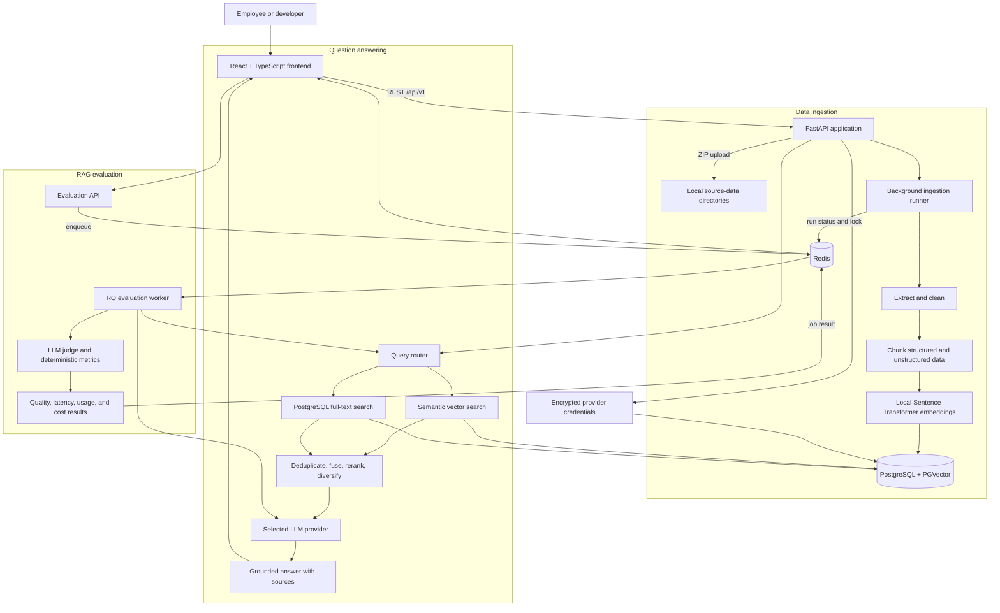

# Employee RAG System

A full-stack, general-purpose Retrieval-Augmented Generation (RAG) application
for employee and company knowledge.

The system accepts structured and unstructured files in a ZIP archive, cleans
and chunks the content, creates local embeddings, stores the resulting vectors
in PostgreSQL with PGVector, and generates grounded answers through a selected
LLM provider. It also includes an end-to-end evaluation workspace for measuring
retrieval quality, answer quality, grounding, citations, latency, and estimated
LLM cost.

This repository provides a deployment-ready foundation with persistent data
services, health checks, secure provider credential storage, background jobs,
and a production-buildable frontend. See [Deployment notes](#deployment-notes)
before exposing it to an external network.

## What the application can do

- Upload one ZIP containing structured and unstructured company data.
- Process PDF, DOCX, TXT, Markdown, CSV, JSON, and XLSX files.
- Extract, clean, normalize, chunk, embed, and index uploaded content.
- Search with semantic retrieval, PostgreSQL full-text keyword retrieval, or a
  fused hybrid strategy.
- Optionally rewrite queries, rerank results, and diversify results by source.
- Generate answers grounded in retrieved employee documents.
- Use Hugging Face, OpenAI, Anthropic, or xAI Grok models.
- Store provider API keys encrypted in PostgreSQL with automatic expiration.
- Track token usage and estimated model cost when pricing is available.
- Generate or upload evaluation datasets.
- Compare multiple answer providers against reviewed ground truth.
- Measure retrieval, answer, citation, abstention, similarity, latency, and cost
  metrics.
- Detect stale evaluation data when the indexed corpus has changed.
- Keep chat unavailable until the first ingestion run completes successfully.

## Supported data

Upload the files inside a `.zip` archive. Folder paths inside the archive are
flattened before storage, so filenames must be unique.

| Data type | Extensions | Processing |
| --- | --- | --- |
| Unstructured | `.pdf`, `.docx`, `.txt`, `.md`, `.markdown` | Text extraction, cleaning, Markdown normalization, and section-aware chunking |
| Structured | `.csv`, `.json`, `.xlsx` | Record or worksheet parsing followed by structured chunk generation |

Default upload limits are:

- 50 MB compressed ZIP size
- 200 MB total uncompressed size
- 1,000 files per archive
- No silent overwriting of existing filenames

These values are defined centrally in `app/api/config.py`.

## Architecture



### Main request flows

1. **Ingestion:** ZIP upload → validation → extraction → cleaning → chunking →
   local embeddings → PGVector index.
2. **Chat:** question → selected retrieval strategies → optional reranking →
   retrieved context → selected LLM → grounded answer and sources.
3. **Evaluation:** reviewed questions and references → retrieval → provider
   answers → judge and deterministic metrics → dashboard results.

## Technology and tools

| Area | Technology | Purpose |
| --- | --- | --- |
| Backend language | Python 3.12+ | API, ingestion, retrieval, evaluation, and worker logic |
| API framework | FastAPI, Uvicorn, Pydantic | Typed REST API, validation, serialization, and serving |
| Frontend | React 19, TypeScript | User, developer, settings, data, and evaluation interfaces |
| Frontend tooling | Vite | Development server, API proxy, and production build |
| Routing and server state | React Router, TanStack Query | Client navigation, API caching, polling, and mutations |
| UI and charts | Lucide React, Recharts | Icons and evaluation visualizations |
| Relational database | PostgreSQL 16 | Credential metadata, full-text retrieval, and application data |
| Vector database | PGVector | Embedding storage and semantic similarity search |
| Cache and queue | Redis 7, RQ | Ingestion status, distributed locks, evaluation jobs, and results |
| RAG integration | LangChain Core and LangChain PostgreSQL | Document models, provider integration, and PGVector access |
| LLM integrations | LangChain OpenAI, Anthropic, and Hugging Face | OpenAI, xAI-compatible, Anthropic, and Hugging Face model clients |
| Local embeddings | Sentence Transformers | Offline document and query embeddings |
| Default embedding model | `sentence-transformers/all-MiniLM-L6-v2` | 384-dimensional local embeddings on CPU |
| Document parsing | PyPDF, python-docx, openpyxl | PDF, DOCX, and XLSX extraction |
| Security | `cryptography` with AES-256-GCM | Encryption of provider API keys at rest |
| Python package manager | uv | Reproducible dependency installation and command execution |
| JavaScript package manager | npm | Frontend dependency installation and scripts |
| Containers | Docker Compose | PostgreSQL/PGVector and Redis services with persistent volumes |
| Testing and validation | pytest, ESLint, TypeScript compiler | Backend tests, frontend linting, and type checking |

## Retrieval capabilities

Developer mode exposes the retrieval pipeline controls:

| Strategy | Description |
| --- | --- |
| Semantic search | Finds conceptually similar chunks using local embeddings and PGVector |
| Keyword search | Uses PostgreSQL full-text search for exact or lexical matches |
| Hybrid fusion | Combines semantic and keyword rankings with reciprocal-rank fusion |
| Query rewriting | Removes conversational noise and produces a concise search query without another LLM call |
| Reranking | Rescores candidate chunks using local embedding similarity |
| Source diversity | Spreads final results across distinct source files |

## RAG quality evaluation

The evaluation workspace is intentionally separate from normal ingestion and
chat. Evaluation runs only when a developer explicitly requests it.

It supports:

- Generating ground-truth JSONL records from reviewed questions.
- Uploading an existing validated JSONL evaluation dataset.
- Comparing up to four answer providers in one run.
- Selecting a separate provider as the evaluation judge.
- Corpus and evidence fingerprints for stale-data detection.
- Per-case errors, warnings, retrieved sources, timings, and usage.
- Provider-level summaries and pass rates.

Metrics include:

| Category | Metrics |
| --- | --- |
| Retrieval | Precision@K, Recall@K, reciprocal rank, average precision, nDCG, source precision, source recall |
| Answer quality | Correctness, groundedness, completeness, relevance, and overall score |
| Citations | Citation accuracy, coverage, and deterministic validity |
| Behavior | Abstention correctness, unsupported claims, and missing facts |
| Similarity | Lexical similarity and local-embedding semantic similarity |
| Operations | Retrieval time, generation time, grading time, total latency, token usage, and estimated cost |

Machine-generated ground truth is marked `machine_generated`. Review it and set
its `review_status` to `approved` before relying on evaluation scores.

## Prerequisites

Install the following before starting:

- Docker Desktop or Docker Engine with Docker Compose
- Python 3.12 or newer
- [uv](https://docs.astral.sh/uv/)
- Node.js 20 or newer and npm
- An API key for at least one supported LLM provider

No `.env` file is required. Application defaults are stored in
`app/api/config.py`; provider model names and API keys are entered through the
Settings page.

## Install and start the application

Run the following commands from the repository root unless a step says
otherwise.

### 1. Install backend dependencies

```bash
uv sync
```

### 2. Start PostgreSQL/PGVector and Redis

```bash
docker compose up -d
docker compose ps
```

Wait until both services report a healthy status.

The default local ports are:

| Service | Address |
| --- | --- |
| PostgreSQL/PGVector | `localhost:6024` |
| Redis | `localhost:6379` |

### 3. Start the backend API

Open a new terminal in the repository root:

```bash
uv run uvicorn app.api.main:app --reload
```

The API is available at:

- API base: `http://localhost:8000/api/v1`
- Interactive API documentation: `http://localhost:8000/docs`

### 4. Start the evaluation worker

Open another terminal in the repository root:

```bash
uv run employee-rag-worker
```

The worker is required for asynchronous evaluation-dataset generation and
evaluation runs. Normal ZIP ingestion and chat do not require this separate
worker.

### 5. Install and start the frontend

Open another terminal:

```bash
cd frontend
npm install
npm run dev
```

Open `http://localhost:5173`.

## Use the application

### 1. Configure an LLM provider

1. Open **Settings**.
2. Select Hugging Face, OpenAI, Anthropic, or Grok.
3. Enter the exact model ID used by that provider.
4. Enter the provider API key.
5. Choose when the saved key should expire.
6. Select **Save encrypted credential**.

The plaintext key is never returned to the browser after it is saved.

### 2. Upload company data

1. Switch to **Developer** mode.
2. Open **Data**.
3. Select a ZIP containing supported files.
4. Select **Upload ZIP**.
5. Review the structured and unstructured file counts.

When no successful ingestion exists, the home route automatically displays the
data setup screen instead of chat—even in User mode.

### 3. Run ingestion

1. Select **Start ingestion**.
2. Keep the API running while the status changes from `pending` to `running`.
3. Wait for **Knowledge base ready**.
4. Select **Open chat**.

Chat is unlocked only when ingestion reaches `completed`. Uploading another ZIP
resets the status to `idle`, and chat remains locked until the new ingestion run
finishes successfully.

The first ingestion may take longer because Sentence Transformers can download
the embedding model into the local model cache.

### 4. Ask questions

1. Open **Ask**.
2. Select a configured model provider.
3. Enter an employee or company question.
4. In Developer mode, adjust the retrieval strategies if needed.
5. Submit the question and review the answer, sources, retrieved chunks, token
   usage, and request diagnostics.

### 5. Evaluate the RAG system

1. Make sure the evaluation worker is running.
2. Switch to **Developer** mode and open **Evaluation**.
3. Create a ground-truth dataset by either:
   - uploading a validated JSONL dataset, or
   - entering questions and generating references with a configured provider.
4. Review machine-generated ground truth before treating it as authoritative.
5. Select one or more answer providers.
6. Select a judge provider.
7. Choose the retrieval settings to evaluate.
8. Start the run and wait for the dashboard results.

Evaluation datasets are limited to 10 MB and 100 records by default.

## Provider credential security

- API keys and model selections are not read from `.env`.
- Credentials are encrypted with AES-256-GCM before PostgreSQL storage.
- API responses expose only a four-character key hint.
- Expired credentials are rejected immediately and deleted automatically.
- Keys can be deleted manually from the Settings page.
- Local development creates the installation encryption key at
  `.secrets/credential_encryption_key`.
- Container deployments can mount the key read-only at
  `/run/secrets/credential_encryption_key`.

Back up the encryption key securely. Deleting it makes existing encrypted
credentials unreadable. Removing a credential from this application does not
revoke it at the provider; revoke compromised keys in the provider dashboard.

## Project structure

```text
Employee_Rag_System/
├── app/
│   ├── api/                 # FastAPI routes, controllers, schemas, and worker
│   ├── core/                # Embeddings, PGVector, Redis, and credential storage
│   ├── ingestion/           # Extraction, cleaning, chunking, and indexing
│   ├── retrieval/           # Semantic, keyword, hybrid, and reranking logic
│   └── evaluation/          # Datasets, metrics, jobs, judging, and reports
├── frontend/
│   └── src/                 # React pages, components, API client, and styles
├── tests/                   # Backend unit and API tests
├── docker-compose.yml       # PostgreSQL/PGVector and Redis services
├── pyproject.toml           # Python dependencies and command-line scripts
└── README.md
```

Generated data is stored in ignored local directories:

```text
data/             # Unstructured uploaded files
structured_data/  # Structured uploaded files
temp_data/        # Cleaned intermediate Markdown
evaluation_data/  # Generated or uploaded evaluation JSONL files
```

Document vectors and encrypted credential records are stored in PostgreSQL.
Redis stores ingestion state, distributed locks, evaluation jobs, and temporary
job results.

## Useful commands

### Backend tests

```bash
uv run pytest -q
```

### Frontend lint and production build

```bash
cd frontend
npm run lint
npm run build
```

### Stop infrastructure

```bash
docker compose down
```

To also delete PostgreSQL and Redis volumes, use `docker compose down -v` only
when permanent local data deletion is intended.

## API overview

All application endpoints use the `/api/v1` prefix.

| Method | Endpoint | Purpose |
| --- | --- | --- |
| `POST` | `/data/upload` | Validate and store an uploaded ZIP |
| `POST` | `/ingestion/start` | Start ingestion in the API background runner |
| `GET` | `/ingestion/status` | Read the latest ingestion state |
| `GET` | `/retrieval/search` | Retrieve chunks without generating an answer |
| `POST` | `/answers/generate` | Retrieve evidence and generate a grounded answer |
| `GET` | `/settings/providers` | List masked active provider credentials |
| `POST` | `/settings/providers` | Encrypt and save a provider credential |
| `DELETE` | `/settings/providers/{provider}` | Delete a saved provider credential |
| `POST` | `/evaluations/datasets/upload` | Upload and validate evaluation JSONL |
| `POST` | `/evaluations/datasets/generate/async` | Queue ground-truth generation |
| `POST` | `/evaluations/run/async` | Queue an evaluation run |
| `GET` | `/evaluations/jobs/{job_id}` | Poll an evaluation job and its result |

## Deployment notes

The application is structured for deployment with:

- A separately runnable FastAPI application layer
- A separately buildable React frontend
- A separate RQ evaluation worker
- Persistent PostgreSQL/PGVector and Redis volumes
- Service health checks
- Central Python configuration without end-user `.env` editing
- Encrypted provider credentials and optional Docker secret mounting

The included `docker-compose.yml` currently provisions PostgreSQL/PGVector and
Redis. The API, worker, and frontend are started with the commands above. To
operate the entire stack as containers, add production images for those three
application processes and place a TLS reverse proxy in front of them.

Before an internet-facing or multi-user deployment, also add:

- Authentication and role-based authorization
- Per-user or per-tenant data and credential ownership
- HTTPS/TLS termination
- A managed secret store and encryption-key backup procedure
- Request throttling, audit logging, monitoring, and database backups
- Network rules that keep PostgreSQL and Redis private

Until those controls are added, run the application only in a trusted private
environment.

## Troubleshooting

### Chat shows the data setup screen

This is expected until ingestion completes. Upload a ZIP and start ingestion.
If the last run failed, review the error displayed on the Data page and retry.

### PostgreSQL or Redis is unavailable

```bash
docker compose ps
docker compose up -d
```

Both services should report healthy before starting ingestion or evaluation.

### No provider appears on the Ask page

Open Settings and save an unexpired API key and model name for at least one
provider.

### Evaluation stays queued

Start the worker from the repository root:

```bash
uv run employee-rag-worker
```

### An uploaded filename already exists

Uploads never silently overwrite source data. Rename the file in the ZIP, or
remove the old local source file only when replacement is intentional, and then
upload again.
