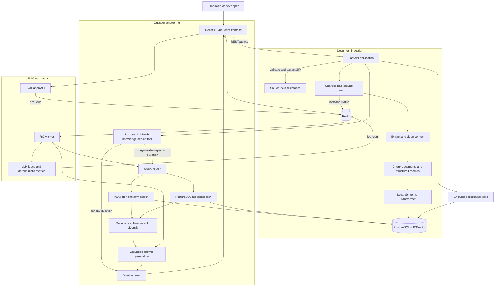

# Architecture

The Employee RAG System separates document ingestion, retrieval, answer
generation, evaluation, and UI concerns while sharing PostgreSQL/PGVector and
Redis as infrastructure services.

## System diagram



## Components

| Component | Responsibility |
| --- | --- |
| React frontend | User and developer modes, data upload, chat, provider settings, and evaluation dashboards |
| FastAPI application | Validated REST endpoints, ingestion orchestration, retrieval, answers, settings, and job submission |
| Ingestion pipeline | Text extraction, normalization, chunking, metadata creation, embeddings, and indexing |
| Query router | Semantic and keyword search selection, hybrid fusion, rewriting, reranking, and source diversity |
| LLM layer | Provider selection, knowledge-search tool choice, grounded prompting, upstream error handling, usage, and cost calculation |
| Evaluation engine | Ground-truth generation, freshness checks, answer comparison, judging, and aggregation |
| RQ worker | Executes asynchronous dataset-generation and evaluation jobs |
| PostgreSQL/PGVector | Vectors, chunk metadata, full-text retrieval data, and encrypted provider credentials |
| Redis | Distributed ingestion lock, persistent ingestion status, job queues, and temporary evaluation results |
| Local filesystem | Uploaded source files, cleaned intermediate data, evaluation JSONL, and the installation key |

## Repository layout

```text
Employee_Rag_System/
├── app/
│   ├── api/                 # FastAPI routes, controllers, schemas, and worker
│   ├── core/                # Embeddings, PGVector, Redis, and credentials
│   ├── ingestion/           # Extraction, cleaning, chunking, and indexing
│   ├── retrieval/           # Semantic, keyword, fusion, and reranking logic
│   └── evaluation/          # Datasets, metrics, jobs, judging, and reports
├── docs/                    # Detailed project documentation
├── frontend/src/            # React pages, components, API client, and styles
├── tests/                   # Backend unit and API tests
├── docker-compose.yml       # PostgreSQL/PGVector and Redis
├── pyproject.toml           # Python dependencies and command entry points
└── README.md                # Project overview and quick start
```

## Ingestion flow

1. The frontend sends a multipart ZIP to `POST /api/v1/data/upload`.
2. The API checks compressed size, member paths, extracted size, and file count.
3. Unsupported files are ignored. Supported files are flattened, collisions
   receive a numeric suffix, and files are routed to `data/` or
   `structured_data/`.
4. A successful upload invalidates the previous ingestion completion state.
5. `POST /api/v1/ingestion/start` acquires a Redis-backed distributed lock.
6. Unstructured documents are extracted and normalized into temporary Markdown.
7. Markdown documents and structured records are converted into deterministic
   chunks with source metadata.
8. The local embedding model embeds each batch.
9. Chunks are upserted into the configured PGVector table.
10. Redis records `completed` or `failed`, including timestamps and a safe error.

Only one ingestion run can hold the distributed lock at a time. The lock has a
safety timeout, while the latest result is persistent because it controls chat
readiness. Later ZIP uploads add files and re-run ingestion over the combined
source set; existing files are preserved and incoming name collisions are
stored with a numeric suffix rather than replacing them.

The vector erase operation acquires the same distributed lock, drops only the
configured vector table, clears retrieval caches, and resets readiness to
`idle`. It does not delete source files, evaluation data, or credentials.

## Retrieval and answer flow

The query router accepts five independent controls:

- Semantic search through PGVector
- Keyword search through PostgreSQL full-text search
- Deterministic query rewriting
- Local embedding reranking
- Source diversity

The selected LLM first receives a `search_employee_knowledge` tool. It calls the
tool for organization-specific questions and answers general requests directly.
The query router, embedding model, and PGVector connection are initialized only
when the tool is called.

When semantic and keyword search are both enabled, their ranked results are
deduplicated and combined with reciprocal-rank fusion. Candidate retrieval uses
up to 20 chunks when reranking or diversification is requested; the final
response contains at most five chunks.

When retrieval is used, the selected chunks and their metadata are supplied to
the configured LLM in a separate grounded prompt. The API returns whether the
tool was used, the answer, provider, model, combined usage, effective query,
applied strategies, and source chunks. Evaluation deliberately continues to
retrieve for every case so it measures the configured RAG pipeline consistently.

The backend does not maintain conversation history and does not automatically
ingest chat messages. Each answer request is processed independently.

## Evaluation flow

1. A developer requests ground-truth generation. The worker derives balanced
   questions from artifacts retained by ingestion; JSONL persistence is internal
   to the application.
2. Asynchronous requests are placed on the Redis evaluation queue.
3. The RQ worker retrieves evidence, calls the selected answer providers, and
   calls the chosen judge provider.
4. Deterministic retrieval, citation, similarity, timing, usage, and cost
   metrics are combined with judge scores.
5. The result is stored temporarily with the Redis job and polled by the UI.

Evaluation does not run automatically during ingestion, retrieval, or normal
answer requests.

## Stored data

| Location | Data | Persistence |
| --- | --- | --- |
| PostgreSQL/PGVector | Document vectors, chunk metadata, encrypted credentials, provider/model metadata | Docker named volume |
| Redis | Ingestion state, lock, queues, job metadata, and job results | Docker named volume with append-only persistence |
| `data/` | Uploaded unstructured source files | Local filesystem; ignored by Git |
| `structured_data/` | Uploaded structured source files | Local filesystem; ignored by Git |
| `temp_data/` | Cleaned intermediate Markdown | Local filesystem; ignored by Git |
| `evaluation_data/` | Generated evaluation JSONL | Local filesystem; ignored by Git |
| `.secrets/` | Local credential encryption key | Local filesystem; ignored by Git |

For container or multi-instance deployment, local data paths must be backed by
persistent shared storage appropriate to the topology.

## Frontend readiness gate

The home route checks `GET /api/v1/ingestion/status` before rendering chat. Any
state other than `completed` shows the data setup page. The Data page polls while
the state is `pending` or `running`, and a later upload returns the system to
`idle` until re-ingestion succeeds.
