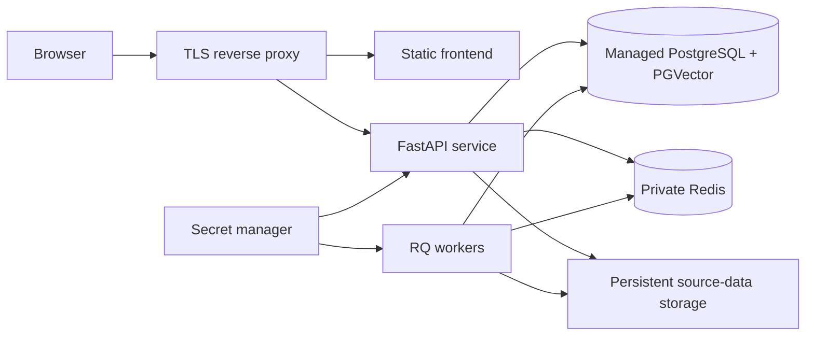

# Deployment

The repository is organized as a deployment-ready foundation, with separate
frontend, API, worker, database, and queue concerns. The included Compose file
currently provisions only PostgreSQL/PGVector and Redis; it is not yet a
one-command production deployment of every application process.

## Current local topology

```text
Browser
  └── Vite frontend :5173
        └── FastAPI :8000
              ├── PostgreSQL/PGVector :6024
              ├── Redis :6379
              ├── local source-data directories
              └── local credential encryption key

RQ worker
  ├── Redis :6379
  ├── PostgreSQL/PGVector :6024
  └── evaluation-data directory
```

Docker Compose provides health checks and persistent named volumes for the two
stateful infrastructure services. API and frontend commands are documented in
[Installation](installation.md).

## Recommended production topology



In this topology:

- A web server or CDN serves the built frontend.
- The reverse proxy routes `/api` to FastAPI.
- PostgreSQL and Redis remain private.
- API and workers receive production configuration and secrets through a
  controlled deployment mechanism.
- Source and evaluation data use durable storage accessible to the processes
  that need them.

## Build the frontend

```bash
cd frontend
npm ci
npm run lint
npm run build
```

Static output is written to `frontend/dist/`. Serve it with a production web
server and route `/api/*` to the backend. Vite's development proxy is not used in
the production build.

## Run application processes

The backend package provides these entry points:

| Process | Command | Role |
| --- | --- | --- |
| API | `uv run employee-rag-system` | FastAPI HTTP service |
| Ingestion CLI | `uv run employee-rag-ingest` | Direct one-off ingestion |
| Evaluation worker | `uv run employee-rag-worker` | RQ background jobs |
| Dataset generator | `uv run employee-rag-generate-eval ...` | Direct JSONL generation |

For production, run the API and worker under an orchestrator or process manager
that restarts failed processes and captures logs. Define worker counts, timeouts,
health probes, and graceful-shutdown behavior.

## Persistence requirements

| Data | Required storage |
| --- | --- |
| PGVector index and credentials | Persistent PostgreSQL database and backups |
| Redis state and evaluation jobs | Persistent Redis or an accepted loss/retry policy |
| `data/` | Persistent source-data volume |
| `structured_data/` | Persistent source-data volume |
| `temp_data/` | Rebuildable working volume |
| `evaluation_data/` | Persistent evaluation dataset volume |
| Credential encryption key | Secret manager or protected read-only secret mount |

Database backups without the matching credential encryption key cannot restore
provider credentials. Source-data and evaluation-data backups are separate from
the PostgreSQL volume.

## Scaling considerations

### API replicas

The Redis ingestion lock prevents simultaneous ingestion across API processes,
but source directories must be shared consistently across replicas. Normal
answer requests are otherwise suitable for horizontal API scaling when all
replicas share PostgreSQL, Redis, the same embedding model, and the same
credential encryption key.

### Ingestion

Ingestion currently runs as a FastAPI background task. A process restart during
ingestion can interrupt the run. For stricter production guarantees, move
ingestion execution to a durable worker queue and make recovery explicit.

### Evaluation workers

Multiple RQ workers can consume the evaluation queue. Size concurrency according
to provider rate limits, model cost, CPU and memory required by local embeddings,
and PostgreSQL capacity.

### Local embeddings

Every API or worker process that performs retrieval loads the configured
Sentence Transformer. Pre-download or cache the model in immutable images or a
shared read-only cache to avoid cold-start downloads.

## Secrets and configuration

The central Python configuration removes customer `.env` setup. For production,
infrastructure credentials should not remain development constants in source.
Integrate the deployment platform's secret manager or a generated protected
configuration layer while preserving the no-manual-setup customer experience.

Mount the credential encryption key at:

```text
/run/secrets/credential_encryption_key
```

Use the same key for every API or worker replica that must access the same
encrypted credential table.

## Network and TLS

- Expose only the TLS reverse proxy publicly.
- Keep PostgreSQL and Redis on private networks.
- Restrict administrative routes with authentication and authorization.
- Apply request-body limits that match or are lower than application limits.
- Configure sensible connect, request, and upstream model timeouts.

## Backups and recovery

Back up these items together:

1. PostgreSQL, including the PGVector table and credential table.
2. Uploaded structured and unstructured source files.
3. Evaluation datasets.
4. The credential encryption key in a separate secure backup system.
5. Deployment configuration and exact application version.

Test restoration regularly. After restoration, verify retrieval, credential
decryption, ingestion status, and one representative evaluation job.

## Observability

Before production, add:

- API request, error-rate, and latency metrics
- Ingestion duration and failure alerts
- Queue depth and worker health monitoring
- PostgreSQL and Redis capacity monitoring
- Provider failure, timeout, usage, and cost monitoring
- Structured logs with sensitive-data controls
- Audit events for credentials, uploads, ingestion, and evaluation

## Release checklist

- [ ] Backend tests pass.
- [ ] Frontend lint and production build pass.
- [ ] Database initialization is verified.
- [ ] Encryption key backup and restoration are tested.
- [ ] Source and evaluation volumes are persistent.
- [ ] TLS, authentication, authorization, and rate limiting are enabled.
- [ ] Database and Redis are private and use production credentials.
- [ ] Provider rate and cost limits are configured operationally.
- [ ] Monitoring, alerting, and backups are active.
- [ ] A rollback procedure has been tested.
